# AgentCAD

**An agent harness for CAD.** Describe a machine in plain words. AI agents design every part as real CAD, simulate how it behaves, read the results, fix what fails, and hand you printable parts, drawings and STEP files.

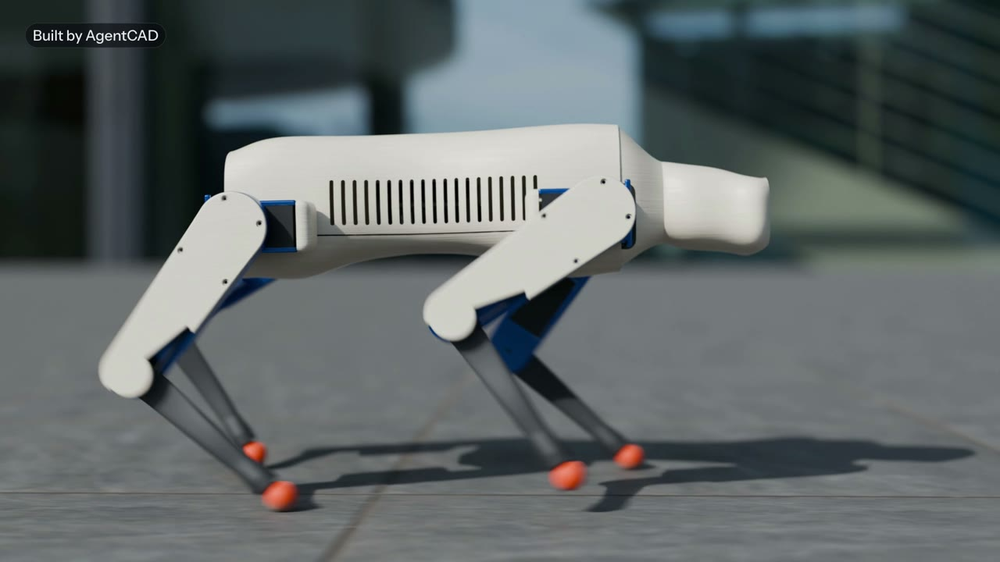

**Demo video (2:13):** [watch it](https://github.com/poyato22/agentcad/releases/latest)

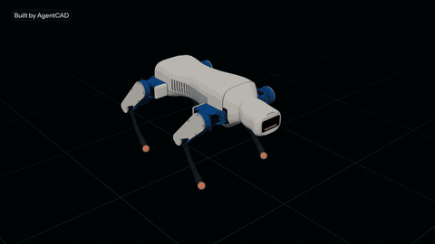

## How it works

1. **Describe a machine.** "A 1.6 kg quadruped robot dog that can trot at 0.5 m/s, belt-driven knees, printable."
2. **Agents design it.** A lead agent splits the work between designer agents (legs, belt drive, chassis) that write parametric CAD (build123d on OpenCASCADE), with an Onshape copy as the master.
3. **It tests its own work.** Agents run simulations to see how the parts would behave in real life, read the results and fix the design, then run them again.

| | |
|---|---|
| 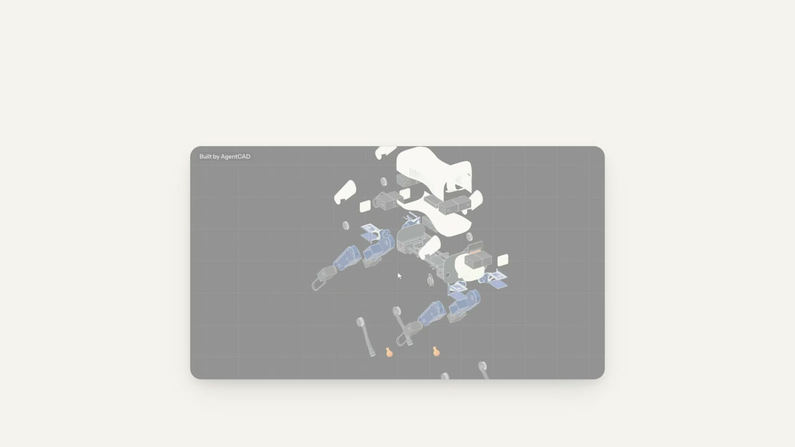 | 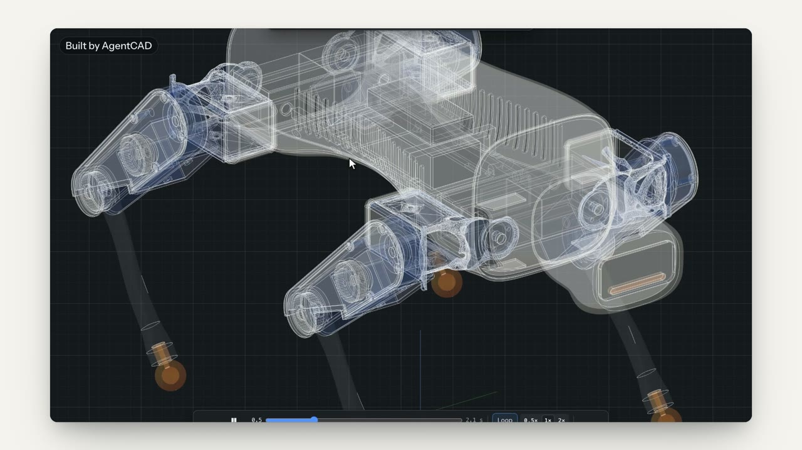 |
| The parts coming together | Inside: motors, belts and electronics |

## Simulation, built in

Wind (CFD with OpenFOAM and a built-in lattice-Boltzmann solver), vibration modes, stress (FEA with CalculiX), buckling, thermal, drop, dynamics and gait (MuJoCo), range of motion, and clash detection across a joint's whole sweep.

| | |
|---|---|
| 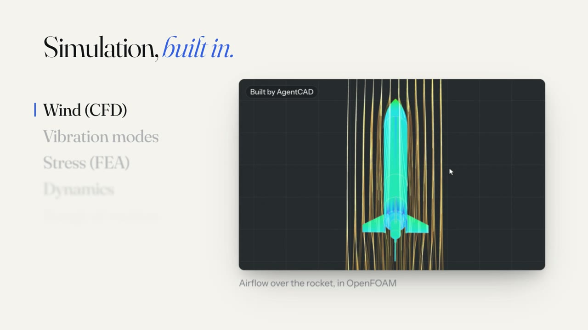 | 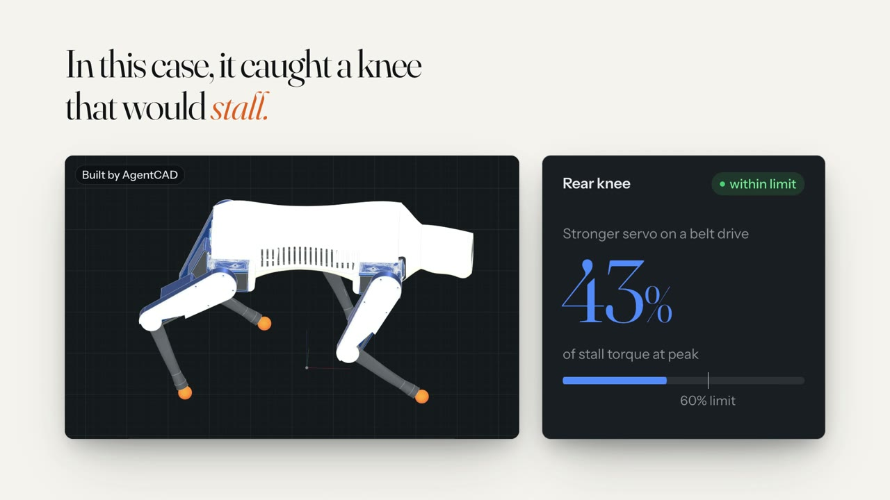 |
| Airflow over the rocket | Dynamics caught a rear knee that would stall |

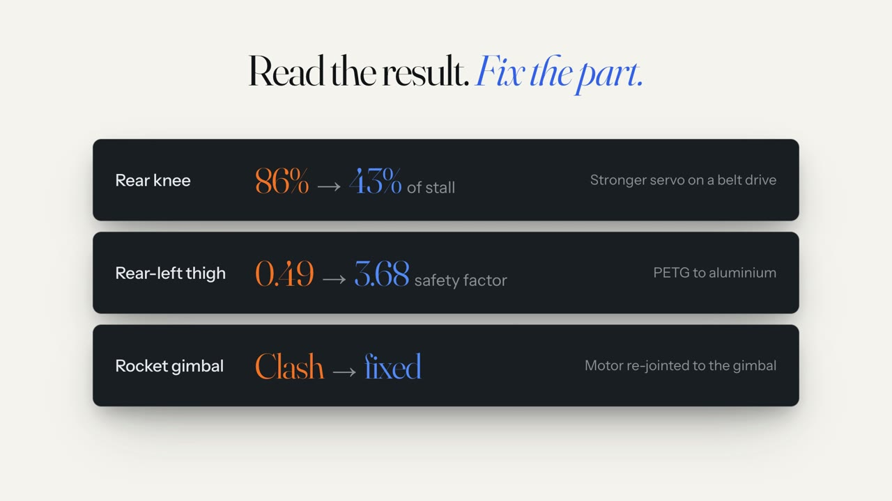

In the dog build, simulation caught a rear knee at 86% of stall torque (fixed to 43% with a stronger servo on a belt drive), a rear thigh at a safety factor of 0.49 (3.68 after moving it from PETG to aluminium), and a clash in the rocket's gimbal (the motor was re-pointed). All of these are simulation results, not physical tests.

## Same harness, other machines

| | |
|---|---|
| 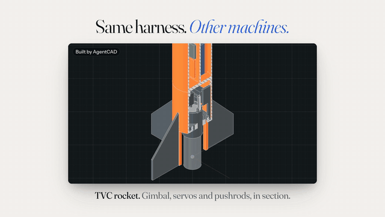 | 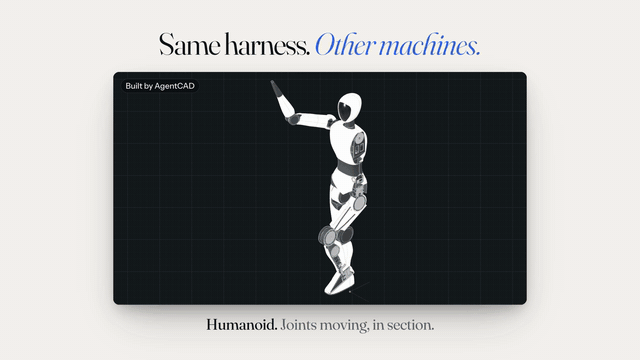 |
| Humanoid: 125 parts, 29 joints | Strandbeest: eight Jansen legs on one crank |
| 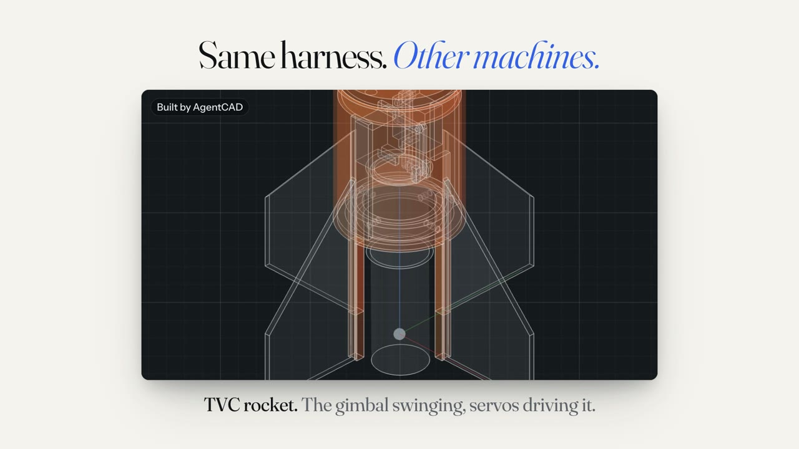 | 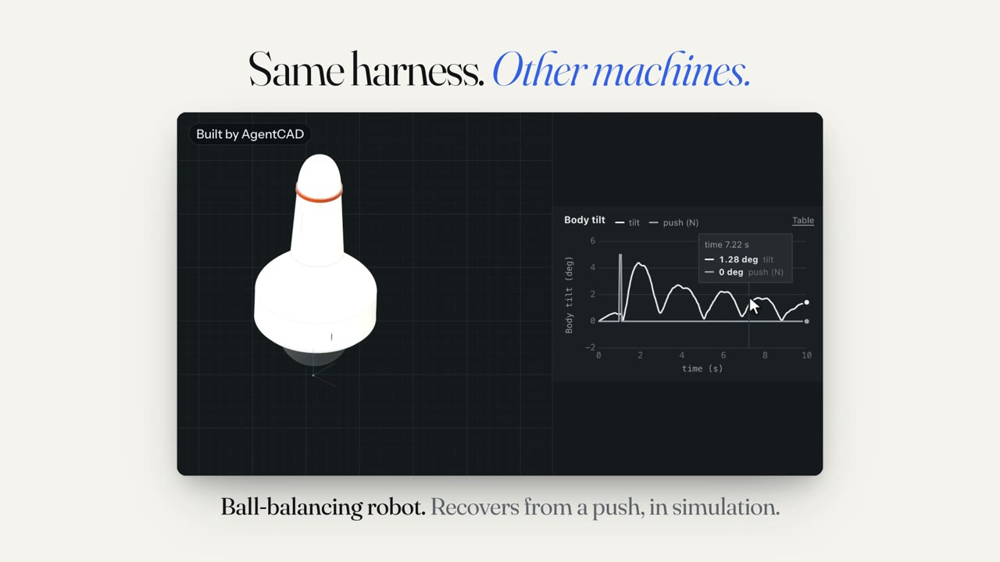 |
| Thrust-vectoring rocket: the gimbal swinging, servos driving it | Ball-balancing robot: recovers from a push, in simulation |
| 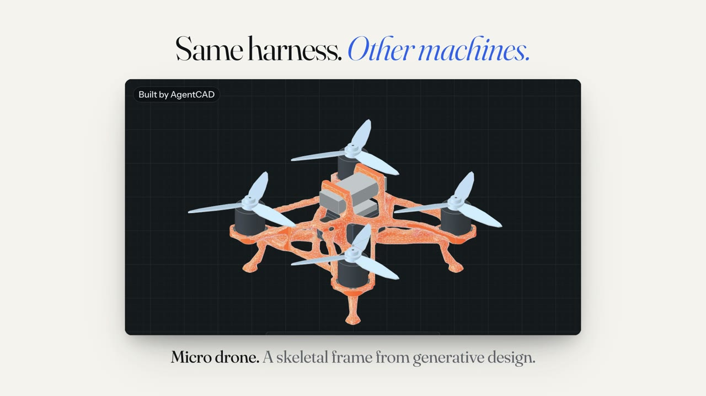 | 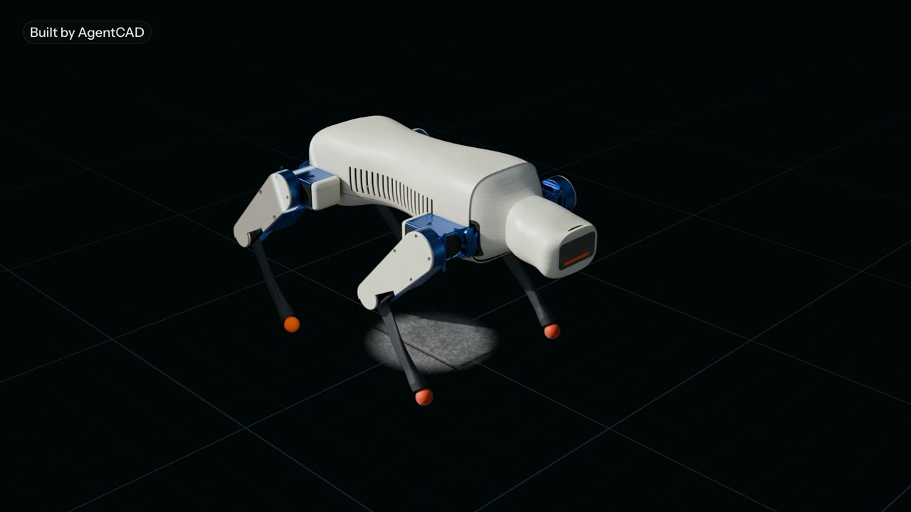 |
| Micro drone: a skeletal frame from generative design | The robot dog in the app's viewer |

## Benchmarks

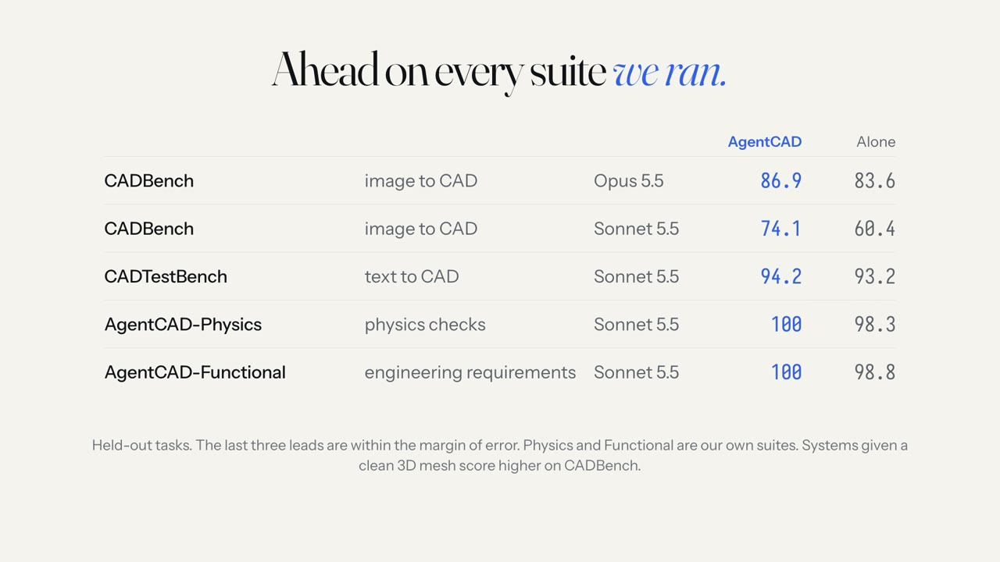

| Suite | Task | Model | AgentCAD | Model alone |
|---|---|---|---|---|
| CADBench | image to CAD | Opus 5.5 | **86.9** | 83.6 |
| CADBench | image to CAD | Sonnet 5.5 | **74.1** | 60.4 |
| CADTestBench | text to CAD | Sonnet 5.5 | **94.2** | 93.2 |
| AgentCAD-Physics | physics checks | Sonnet 5.5 | **100** | 98.3 |
| AgentCAD-Functional | engineering requirements | Sonnet 5.5 | **100** | 98.8 |

CADBench scores are volumetric IoU on 60 held-out tasks: +3.3 points on Opus 5.5 (95% CI 1.6 to 5.1) and +13.7 on Sonnet 5.5. AgentCAD with Sonnet still scores 9.5 points below Opus alone. The last three leads are within the margin of error, and AgentCAD-Physics and AgentCAD-Functional are our own suites. Systems that are given a clean 3D mesh instead of an image score higher on CADBench.

## What's in the app

- A Mac app (Tauri and Preact) with a Python core that runs every CAD worker in a macOS sandbox, with no network.
- Agents through Claude Code or the API, with tools exposed over MCP.
- A live 3D viewer with Onshape-style measuring, X-ray, section and exploded views; concept sketches before any CAD; drawings and STEP export; print hand-off to Prusa printers over PrusaLink (Bambu is planned).
- Every irreversible step (merging to Onshape, printing) waits for your approval.

## Running it

macOS 13 or later, Python 3.13 with [uv](https://docs.astral.sh/uv/), Node and Rust.

```sh
cd app
npm install
scripts/build-dev-app.sh      # builds src-tauri/target/release/bundle/macos/AgentCAD.app
```

The app starts the core from this checkout. Sign in to Claude Code first (`claude auth login`).

## Repository

| Path | What |
|---|---|
| `app/` | The desktop app (Tauri, Preact, TypeScript) |
| `core/` | The core: agents, CAD workers, simulation, the `mises` package and CLI |
| `docs/` | Design docs, plans and the media in this README |
| `research/` | Research notes behind the design |

AgentCAD was called Mises during development, so the Python package, CLI, data folder and bundle id still use that name.

Built by Hartigan · [hartigandeely.com](https://hartigandeely.com)
